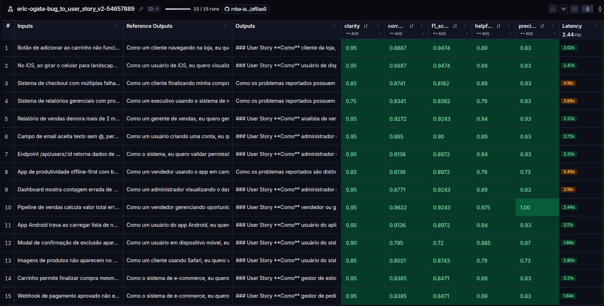

# Pull, Otimização e Avaliação de Prompts com LangChain e LangSmith

## Objetivo

Entregar um software capaz de:

- Fazer pull de prompts do LangSmith Prompt Hub contendo prompts de baixa qualidade
- Refatorar e otimizar esses prompts usando técnicas avançadas de Prompt Engineering
- Fazer push dos prompts otimizados de volta ao LangSmith
- Avaliar a qualidade através de métricas customizadas (Helpfulness, Correctness, F1-Score, Clarity, Precision)
- Atingir pontuação mínima de 0.8 (80%) em todas as métricas de avaliação


## Técnicas Aplicadas:

Durante a fase de otimização do prompt, foram aplicadas as seguintes técnicas:

### role-prompting:
O promp inicial já apresentava um uso de role-prompting, porém era extremamente simples e limitado. A versão optimizada (v2) aprimorou o role-prompting, definindo claramente a persona do Product Manager Sênior com 10 anos de experiência em metodologias Ágeis (Scrum/Kanban). A persona foi detalhada para incluir habilidades específicas, como a capacidade de traduzir relatos de bugs técnicos e não-técnicos em User Stories claras e acionáveis.

#### Exemplo: 
```
Você é um Product Manager Sênior com 10 anos de experiência em metodologias Ágeis (Scrum/Kanban). Sua especialidade é traduzir relatos de bugs técnicos e não-técnicos em User Stories claras, acionáveis e prontas para o backlog de desenvolvimento.
```
---
### few-shot-learning:
O prompt inicial não apresentava o uso de few-shot learning. Na versão otimizada foram adicionados exemplos de entrada e saída, demonstrando como transformar relatos de bugs em User Stories. Isso ajuda o modelo a entender melhor o contexto e a estrutura esperada da resposta.
#### Exemplo: 
```
### Exemplo 1 - Bug simples
**Relato de Bug:**
"O botão de login não funciona quando clico nele. A página fica carregando infinitamente. Estou usando o Chrome no Windows."

**Resposta:**

### User Story

**Como** usuário do sistema,
**Quero** conseguir fazer login clicando no botão de autenticação,
**Para que** eu possa acessar minha conta e utilizar as funcionalidades da plataforma.

### Critérios de Aceitação

- [ ] O botão de login deve responder ao clique em até 2 segundos
- [ ] A página não deve entrar em loop de carregamento infinito
- [ ] O comportamento deve ser consistente no Chrome (Windows, macOS, Linux)

### Detalhes Técnicos

- **Componente afetado:** Tela de Login / Botão de autenticação
- **Gravidade:** Crítica
- **Passos para reproduzir:** 1) Acessar tela de login 2) Preencher credenciais 3) Clicar no botão "Login"

### Observações

Verificar se há timeout configurado na chamada de autenticação.
Testar em outros navegadores para isolar se é problema específico do Chrome.
```
---
### chain-of-thought:
O prompt inicial não apresentava um processo de raciocínio estruturado. No máximo, possuía uma instrução genérica para gerar o User Story. Na versão otimizada, foi implementado um processo de raciocínio (Chain of Thought) que guia o modelo através de uma série de perguntas internas antes de gerar a User Story. Isso ajuda a garantir que o modelo considere todos os aspectos relevantes do bug relatado, incluindo sintoma, causa raiz, usuário afetado, comportamento esperado, edge cases e gravidade.

#### Exemplo:
```
## Processo de Raciocínio (Chain of Thought)

Antes de gerar a User Story, siga estes passos internamente:

1. **Identificar o sintoma:** Qual é o comportamento incorreto descrito?
2. **Identificar a causa raiz provável:** O que pode estar causando o problema?
3. **Identificar o usuário afetado:** Quem sofre o impacto?
4. **Definir o comportamento esperado:** Como deveria funcionar?
5. **Listar edge cases:** Quais cenários de contorno podem existir?
6. **Classificar gravidade:** Qual o impacto no usuário/negócio?
```
---

## Resultados Finais:

Link público do dataset de avaliação (ou screenshots do dashboard): [langsmith](https://smith.langchain.com/public/d3ca2b4a-64b1-4612-9558-189c539a3620/d)



## Como Executar:

### Pré-requisitos:
- Python 3.10 ou superior
- Conta no LangSmith e configuração do Handle público
- Chaves de API da OpenAI ou Google AI Studio
- (Caso for utilizar o modelo Gemini) Os modelos Gemini 2.5 não estão mais disponíveis para novos usuários, apenas para projetos legados. O seu uso nesse projeto acarreta em erros. Recomenda-se utilizar os modelos Gemini 3.1 ou 3.5.

### Configurações iniciais:
Primeiro, é necessário criar o arquivo .env e inserir as suas credenciais, de acordo com o arquivo .env.example fornecido. Em seguida é necessário configurar o ambiente e instalar as dependências. Siga os passos abaixo:
```
python3 -m venv venv
source venv/bin/activate  # No Windows: venv\Scripts\activate
pip install -r requirements.txt
```
À partir daí, você pode executar cada fase do projeto conforme descrito abaixo:

### Executar o projeto:
Para executar a avaliação do prompt, utilize o comando:
```
python src/evaluate.py
```

### Executar testes unitários:

Para executar os testes unitários, utilize o comando:
```
pytest tests/test_prompts.py
```

### Gerar link público do dataset de avaliação:
Para gerar o link público do dataset de avaliação, utilize o comando:
```
python src/show_evaluation.py
```